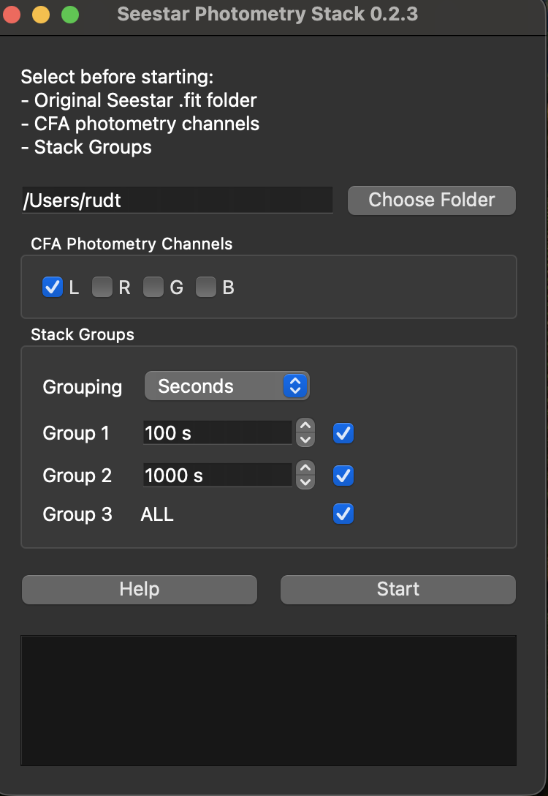

# Seestar Photometry Stack

The current `SeePhot_CFA.py` is maintained centrally in
[SeePhot](https://github.com/Aquarius58/SeePhot) and updated with SeePhot Main
releases. This repository remains the independent project, documentation,
and support page for Seestar CFA extraction and stacking with Siril.

- [Current source code](https://github.com/Aquarius58/SeePhot/blob/main/SeePhot_CFA.py)
- [Direct download](https://raw.githubusercontent.com/Aquarius58/SeePhot/main/SeePhot_CFA.py)

There is no separate code copy or CFA release in this repository.

Siril Python preprocessing script for original Seestar `.fit` frames. The script prepares CFA/Bayer data for downstream photometry workflows by creating photometry-oriented L/R/G/B products and registered stack groups.

## Screenshot



## Features

- Uses original Seestar `.fit` frames directly from one selected source folder.
- Extracts CFA photometry channels `L`, `R`, `G`, and `B` without debayer interpolation.
- Keeps channel products at the original Seestar image size for downstream compatibility.
- Registers frames before stacking.
- Creates stack groups by duration, by frame count, or `ALL`.
- Offers continuous or gap-aware grouping for duration and frame-count
  groups; gap-aware grouping starts a new block after a pause longer than
  three times the median frame cadence. `ALL` always uses all selected frames.
- Exports selected channels from a single CFA frame without stacking.
- Requires stack blocks to meet the configured minimum frame count and,
  for time-based groups, the configured minimum exposure fraction.
- Writes photometry-oriented FITS timing metadata.
- Records output provenance and preserves unambiguous channel metadata.
- Accepts source folders selected through the dialog or pasted as local/file URLs.
- Cleans up stale Siril display state before processing and continues after individual stack-block failures.
- Provides a dark standalone interface with single-instance protection.
- Confirms before clearing existing result folders.

## Limitations

This script does not perform complete photometric measurement.

For differential variable-star photometry and light-curve analysis, use
[SeePhot](https://github.com/Aquarius58/SeePhot). The CFA script can be used
on its own and requires no SeePhot support modules.

## Requirements

- Siril 1.3.0 or newer with Python scripting support.
- `sirilpy` 1.0.13 or newer.
- Python packages: `PyQt6`, `astropy`, and `numpy`.

The script is intended to run inside Siril's Python environment, not as a standalone system-Python program. Missing Python packages are checked and installed through Siril when possible.

## Usage

1. [Download the current script from SeePhot](https://raw.githubusercontent.com/Aquarius58/SeePhot/main/SeePhot_CFA.py)
   and save it as `SeePhot_CFA.py` in a Siril Python script directory.
   Select that directory in Siril's Python scripts settings.
2. Start Siril and run the script from the Scripts menu.
3. Select the folder containing the original Seestar `.fit` frames.
4. Select CFA photometry channels as needed: `L`, `R`, `G`, `B`.
5. Select stack groups: seconds, frame count, or `ALL`.
6. Click `Start`.

## Result Folders

Results are written next to the selected source folder. Original input frames are not modified.

Example source folder:

```text
Light_001
```

Possible result folders:

```text
Light_001_l
Light_001_r
Light_001_g
Light_001_b
Light_001_l-stack100sec
Light_001_l-stack1000sec
Light_001_l-stackall
```

For non-CFA input, stack folders use no channel suffix, for example:

```text
Light_001-stack100sec
```

Temporary folders use `<source>-tmp...` names and are removed when the run ends.

## FITS Timing

In the current published SeePhot script, original Seestar frames with
`DATE-EXP` use `DATE-OBS` as exposure start and `DATE-EXP` as exposure end.
Without `DATE-EXP`, `DATE-OBS` is treated as exposure end and the start is
derived from `EXPTIME`. Files without `DATE-OBS` are skipped; missing
`EXPTIME` uses a 10-second fallback.

Generated stack products use:

- `DATE-OBS`: UTC exposure start
- `DATE-END`: UTC exposure end
- `DATE-AVG`: exposure-weighted midpoint
- `MJD-AVG`: exposure-weighted midpoint as MJD
- `EXPTIME`: summed exposure time of the used frames, excluding gaps
- `NCOMBINE`: number of frames included in the stack

## CFA Channels

For CFA/Bayer input, Siril is used to split measured CFA samples. The script does not create debayer-interpolated RGB images for photometry.

- `L`: mean of one Bayer cell, `(R + G1 + G2 + B) / 4`
- `G`: mean of the two green samples, `(G1 + G2) / 2`
- `R`: measured red CFA sample
- `B`: measured blue CFA sample

`FILTER` and `CHANMODE` are written into the FITS header to document the derived channel.

## Support

Bug reports and support requests:

https://github.com/Aquarius58/siril-seestar-stack/issues

## License

GPL-3.0-or-later. See `LICENSE` and the
[current script](https://github.com/Aquarius58/SeePhot/blob/main/SeePhot_CFA.py)
for details.
